***English** · [Română](README.ro.md)*

<div align="center">

# 🌡️ KenoTemp

**Autonomous battery-powered IoT station for temperature and humidity monitoring**

ESP32 · DHT11 · Li-Ion 18650 · Deep Sleep · Blynk IoT Cloud · 3D-printed enclosure

[](https://www.espressif.com/)
[](https://www.arduino.cc/)
[](https://platformio.org/)
[](https://blynk.io/)
[](LICENSE)

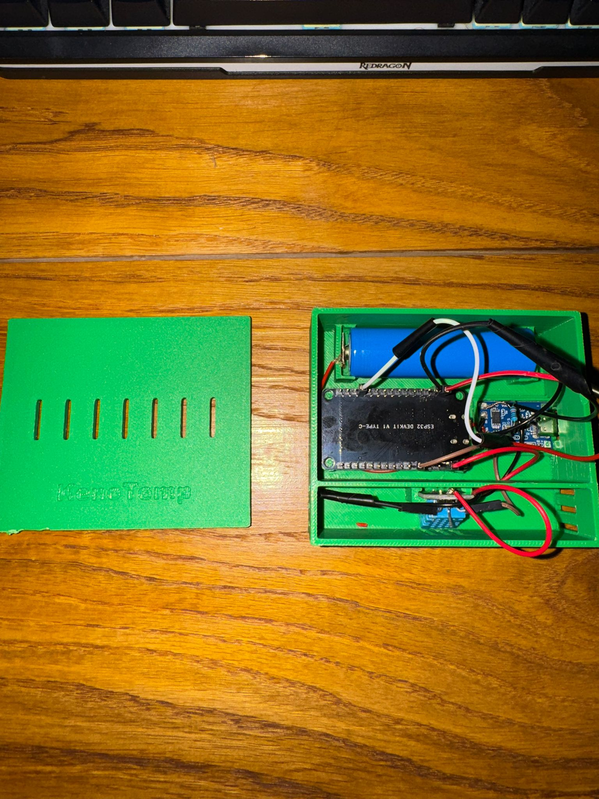

</div>

---

## 📋 Contents

- [About the project](#-about-the-project)
- [Features](#-features)
- [Components](#-components)
- [Tools and software](#-tools-and-software)
- [Wiring](#-wiring)
- [3D enclosure](#-3d-enclosure)
- [How it works](#️-how-it-works)
- [Installation and running](#-installation-and-running)
- [Blynk setup](#️-blynk-setup)
- [Power consumption and battery life](#-power-consumption-and-battery-life)
- [Problems encountered and solutions](#-problems-encountered-and-solutions)
- [Future improvements](#-future-improvements)
- [Project structure](#-project-structure)
- [Gallery](#️-gallery)
- [License](#-license)

---

## 🎯 About the project

**KenoTemp** is a fully autonomous environmental monitoring station powered by a single Li-Ion 18650 cell. It measures temperature and humidity, reports its own battery level and sends everything to a cloud dashboard you can open from a phone or a browser.

The core idea of the project is not the sensor itself — it is **power management**. An ESP32 left permanently connected to Wi-Fi draws around 80–150 mA and drains an 18650 battery in less than a day. KenoTemp solves this with **Deep Sleep**: the board is awake for roughly 7 seconds every 5 minutes and sleeps the rest of the time.

Result: the system runs for **~7–8 days** on a single charge, compared with **under 24 hours** without deep sleep.

The whole assembly sits in an enclosure designed in Autodesk Fusion and 3D-printed, ready to be mounted on a wall.

> 📖 The full development log, with the decisions made along the way (in Romanian): [`docs/Jurnal-de-proiect.txt`](docs/Jurnal-de-proiect.txt)

---

## ✨ Features

| | |
|---|---|
| 🌡️ **Temperature and humidity** | Read from a DHT11 sensor, sent every 5 minutes |
| 🔋 **Battery monitoring** | Resistive divider + internal ADC → raw voltage (V) and percentage (%) |
| 😴 **Deep Sleep** | ~7 s active / 300 s asleep — cuts average consumption by more than 10× |
| ☁️ **Cloud dashboard** | Blynk IoT — live charts, history, CSV export |
| 📱 **Push notification** | Automatic phone alert when the battery drops below 20% |
| 🔌 **USB charging** | TP4056 module with over/under-voltage protection, Type-C port reachable from outside the enclosure |
| 📦 **Custom enclosure** | Designed in Fusion, printed on a Creality Ender-3 V3 KE, with ventilation slots |

---

## 🔧 Components

| # | Component | Role in the project | Relevant specifications | Approx. price |
|---|---|---|---|---|
| 1 | **ESP32 DevKit V1 (Type-C)** | The brain of the system — reads the sensors, connects to Wi-Fi, sends the data, goes into deep sleep | Dual-core Xtensa 240 MHz, Wi-Fi 2.4 GHz + BT, 520 KB SRAM, 4 MB flash, 12-bit ADC | ~35–50 lei |
| 2 | **DHT11 sensor** | Measures air temperature and humidity | 0–50 °C (±2 °C), 20–90 % RH (±5 %), proprietary 1-Wire interface | ~8–12 lei |
| 3 | **Li-Ion 18650 cell** | Power source for the whole system | 3.7 V nominal (3.0–4.2 V), ~2500 mAh | ~15–30 lei |
| 4 | **TP4056 module with protection** | CC/CV charging over USB + protection against over-discharge, overcharge and short circuit | 1 A charging current, USB Type-C input | ~5–8 lei |
| 5 | **2 × 100 kΩ resistor** | 1:2 voltage divider — brings the battery's 4.2 V below the ADC's 3.3 V limit | 5 % tolerance, ~21 µA continuous draw | ~1 leu |
| 6 | **Dupont / stranded wires + solder** | Connecting the modules | — | ~5 lei |
| 7 | **PLA filament (green)** | The 3D-printed enclosure | ~45 g of material | ~5 lei |
| | | | **Total** | **~75–110 lei** |

<div align="center">
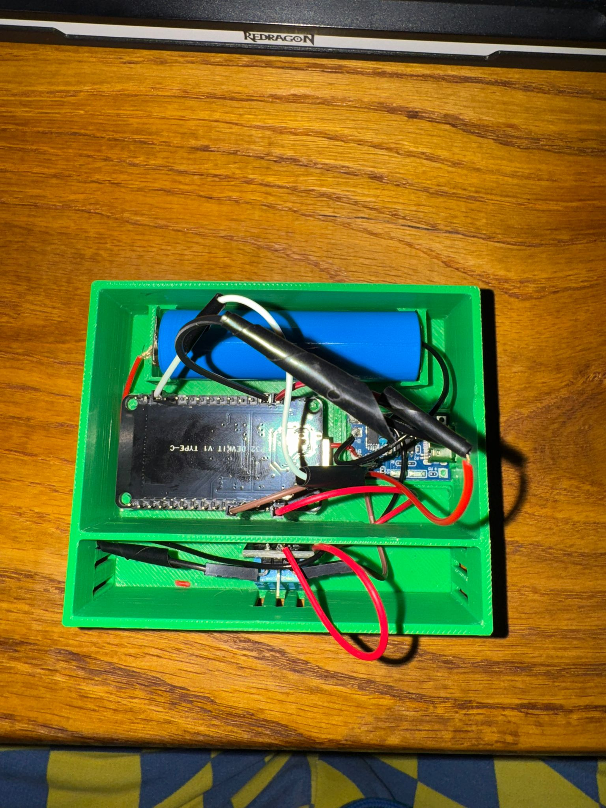
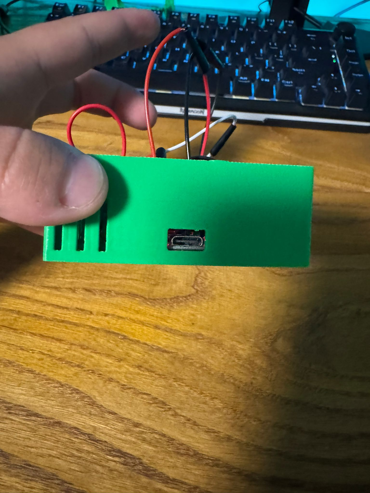
</div>

---

## 🛠️ Tools and software

| Tool | Used for |
|---|---|
| **VS Code + PlatformIO** | Development environment, building and uploading the firmware |
| **Autodesk Fusion** | 3D design of the enclosure (CAD) |
| **Creality Print / slicer** | Slicing the model → G-code |
| **Creality Ender-3 V3 KE** | Printing the enclosure |
| **Blynk IoT** | Cloud platform: dashboard, datastreams, automations, notifications |
| **Digital multimeter** | Measuring the real battery voltage — this exposed the ADC error |
| **Soldering iron + cutter** | Soldering and mechanical fitting of the enclosure |
| **Serial Monitor (115200 baud)** | Live debugging of the firmware |

**Libraries** (resolved automatically by PlatformIO from [`platformio.ini`](platformio.ini)):

```ini
lib_deps =
    adafruit/DHT sensor library @ ^1.4.4
    adafruit/Adafruit Unified Sensor @ ^1.1.9
    blynkkk/Blynk @ ^1.3.2
```

---

## 🔌 Wiring

### Wiring table

| From | To | Notes |
|---|---|---|
| 18650 battery **+** | TP4056 **B+** | |
| 18650 battery **−** | TP4056 **B−** | |
| TP4056 **OUT+** | ESP32 **VIN** | Powers the board |
| TP4056 **OUT−** | ESP32 **GND** | Common ground |
| DHT11 **VCC** | ESP32 **3V3** | |
| DHT11 **GND** | ESP32 **GND** | |
| DHT11 **DATA** | ESP32 **GPIO 4** | `#define DHTPIN 4` |
| TP4056 **OUT+** | R1 (100 kΩ) → node | Upper leg of the divider |
| node | R2 (100 kΩ) → **GND** | Lower leg |
| node (divider midpoint) | ESP32 **GPIO 34** | `#define BATT_PIN 34` — input-only pin, ADC1 |

### The voltage divider

```
   BAT+ (3.0 – 4.2 V)
        │
       ┌┴┐
       │ │ R1 = 100 kΩ
       └┬┘
        ├──────────────► GPIO 34  (1.50 – 2.10 V — safe for the ADC)
       ┌┴┐
       │ │ R2 = 100 kΩ
       └┬┘
        │
       GND
```

The 1:2 ratio means the battery's maximum of **4.2 V** reaches the analog pin as **2.1 V** — comfortably below the 3.3 V limit. In code, the real voltage is reconstructed by multiplying by 2:

```cpp
int   rawADC  = analogRead(BATT_PIN);
float voltage = (rawADC / 4095.0) * 3.3 * 2.0;
voltage = voltage + 0.35;   // calibration — see "Problems encountered"
```

### System diagram

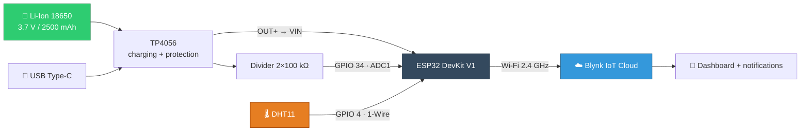

---

## 📦 3D enclosure

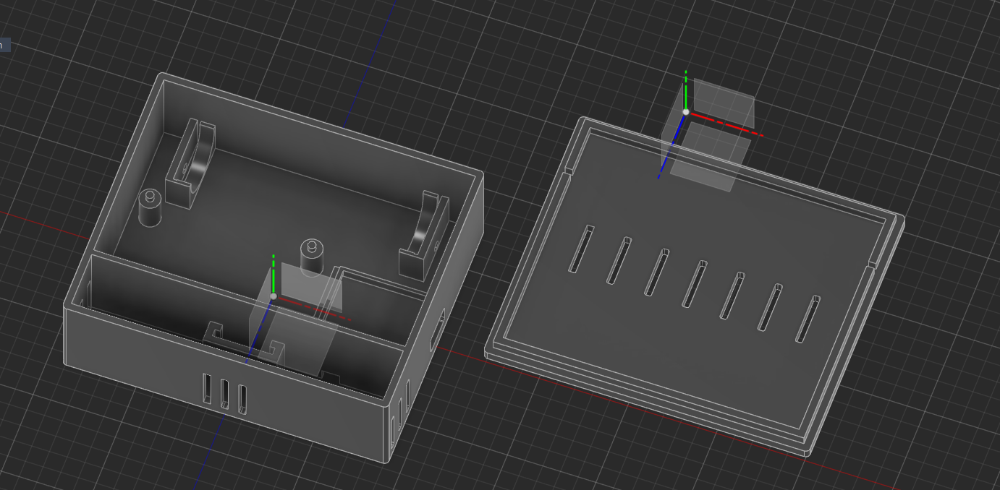

The enclosure was designed from scratch in **Autodesk Fusion**, in two parts:

- **The base** — with a dedicated holder for the 18650 cell, seats for the ESP32 and the TP4056, a side cut-out for the USB Type-C port and ventilation slots on the side;
- **The lid** — with vents above the sensor (without them the DHT11 would read the stale air inside the box rather than the air in the room) and an embossed **KenoTemp** logo.

📄 Print file: [`hardware/CarcasaTermo.stl`](hardware/CarcasaTermo.stl)

**Print settings used:**

| Parameter | Value |
|---|---|
| Printer | Creality Ender-3 V3 KE |
| Material | PLA |
| Layer height | 0.2 mm |
| Infill | 15 % |
| Supports | No |
| Perimeters | 3 |

---

## ⚙️ How it works

The firmware has practically no `loop()` — all the code lives in `setup()`, because **every wake-up from deep sleep restarts the microcontroller from scratch**, like a reset. The full cycle looks like this:

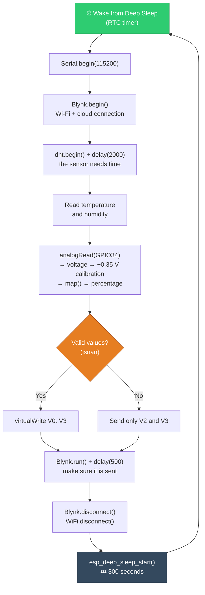

### Datastreams sent to the cloud

| Virtual pin | Quantity | Unit | Range |
|---|---|---|---|
| `V0` | Temperature | °C | −20 … 60 |
| `V1` | Humidity | % RH | 0 … 100 |
| `V2` | Battery voltage | V | 0 … 5 |
| `V3` | Battery percentage | % | 0 … 100 |

---

## 🚀 Installation and running

### 1. Clone the project

```bash
git clone https://github.com/StefanHoria/KenoTemp-IoT-Weather-Station.git
```

### 2. Create the private data file

The sensitive data (Blynk token + Wi-Fi password) **is not in the repository**. Copy the template and fill it in with your own data:

```bash
cp include/secrets.h.example include/secrets.h
```

On Windows:

```bash
copy include\secrets.h.example include\secrets.h
```

Then edit [`include/secrets.h`](include/secrets.h.example):

```cpp
#define BLYNK_TEMPLATE_ID   "TMPLxxxxxxxxx"
#define BLYNK_TEMPLATE_NAME "KenoTemp"
#define BLYNK_AUTH_TOKEN    "your_32_character_token"

#define WIFI_SSID "YourNetworkName"
#define WIFI_PASS "YourNetworkPassword"
```

> ⚠️ The ESP32 works **only on 2.4 GHz Wi-Fi**. 5 GHz networks will not be found.

### 3. Build and upload

```bash
pio run --target upload
```

### 4. Watch it run

```bash
pio device monitor -b 115200
```

Expected output (the firmware's messages are in Romanian):

```
--- Sistemul s-a trezit ---
Ma conectez la WiFi si Blynk...
Date citite. Trimit catre platforma...
Date trimise! Intru in Deep Sleep... Zzz
```

### Resource usage (actual build)

| | Used | Total | |
|---|---|---|---|
| **RAM** | 45.2 KB | 320 KB | 13.8 % |
| **Flash** | 768 KB | 1.25 MB | 58.6 % |

---

## ☁️ Blynk setup

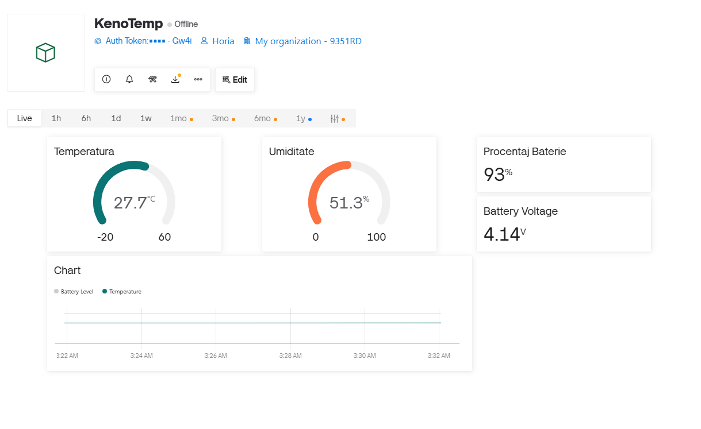

1. Create a new **Template** in the [Blynk Console](https://blynk.cloud) → note the `TEMPLATE_ID` and `AUTH_TOKEN`.
2. In **Datastreams**, add four virtual pins as in the table above (V0–V3).
3. In the **Web Dashboard**, add widgets: two *Gauges* (temperature, humidity), two *Labels* (voltage, percentage) and a *Chart*.
4. For the low-battery notification, go to **Automations** → *When device state changes*.

### The low-battery automation

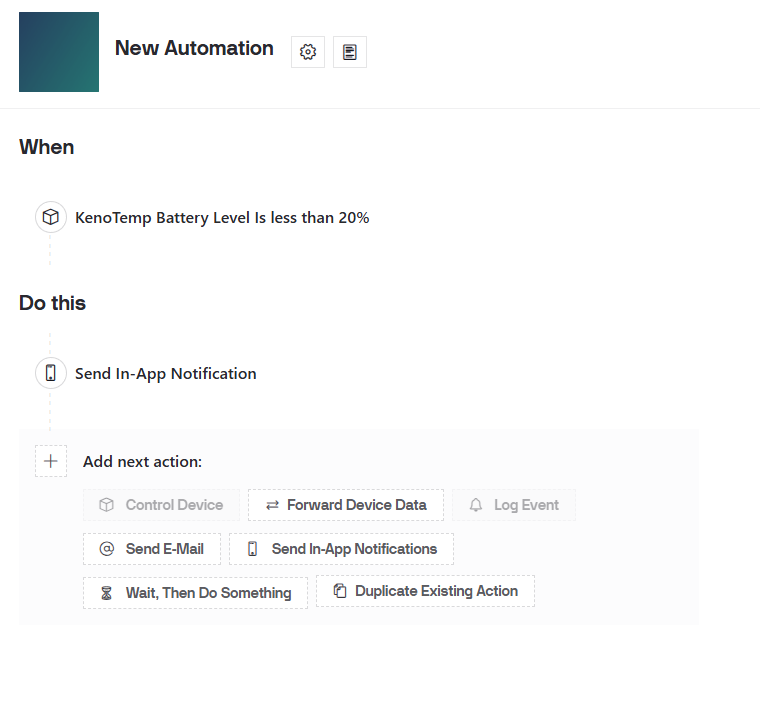

| Condition | Action |
|---|---|
| `KenoTemp Battery Level` **< 20 %** | Send an in-app notification to the phone |

The result, on the phone:

<div align="center">
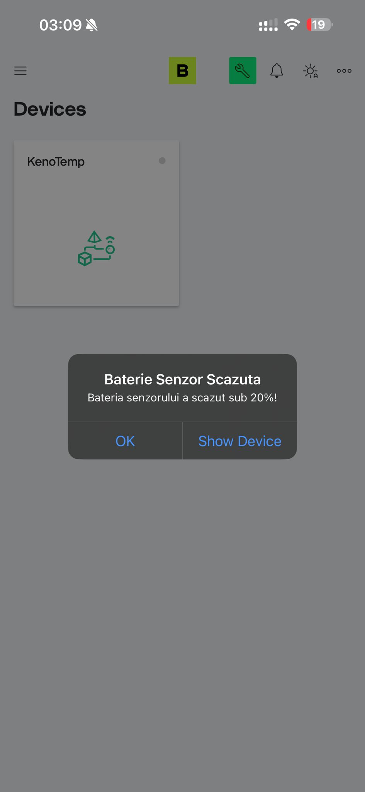
</div>

> 💡 **Important:** for `V3` to show up in the automation list, the datastream has to be explicitly marked as **"Sensor"** in the *Automations* section of the datastream editor. See [Problems encountered](#-problems-encountered-and-solutions).

---

## 🔋 Power consumption and battery life

### Measurements and calculation

| Phase | Duration | Estimated current | Charge / cycle |
|---|---|---|---|
| **Active** (Wi-Fi + reading + sending) | ~7.5 s | ~150 mA | 0.313 mAh |
| **Deep Sleep** (whole DevKit board) | 300 s | ~10 mA | 0.833 mAh |
| | | **Total per cycle (307.5 s)** | **~1.15 mAh** |

```
Cycles per day       = 86,400 s / 307.5 s   ≈ 281
Daily consumption    = 281 × 1.15 mAh       ≈ 323 mAh
Battery life (2500 mAh) = 2500 / 323        ≈ 7.7 days
```

### 🚨 The key observation

**72 % of the energy is spent while "asleep".**

The ESP32 chip itself draws only ~10 µA in deep sleep. But the **DevKit** board carries an AMS1117 linear regulator and a USB-serial chip that stay powered all the time and together draw ~8–12 mA — whether the microcontroller is asleep or not.

Software deep sleep solves only half of the problem. This is exactly the motivation for the main improvement proposed below.

---

## 🐛 Problems encountered and solutions

### 1. ADC error — a 0.35 V offset

| | |
|---|---|
| **Symptom** | The multimeter showed a full battery at **4.20 V**, but the ESP32 reported only **3.85 V** to Blynk. The displayed percentage was completely wrong. |
| **Cause** | Three combined factors: the ESP32's internal ADC is notoriously non-linear at the top of its range, the actual reference voltage differs from the 3.3 V assumed in the formula, and the 100 kΩ resistors have a 5 % tolerance. |
| **Solution** | Software calibration with an offset measured with the multimeter: `voltage = voltage + 0.35;` before computing the percentage. |
| **Result** | The reported value now matches the one measured at the battery terminals. |

### 2. Blynk: "No datastreams exposed for automation"

| | |
|---|---|
| **Symptom** | The low-battery notification rule could not be created — the platform saw no available datastream. |
| **Cause** | For safety reasons, Blynk does not automatically expose virtual pins to the automation engine. |
| **Solution** | Unlock the template in the Web Dashboard → edit the `V3` datastream → explicitly mark it as **"Sensor"** in the *Automations* section. |
| **Result** | The push notification works. |

### 3. The "stuck button syndrome" — the most expensive problem

| | |
|---|---|
| **Symptom** | After assembling everything in the printed enclosure and switching to battery power, the board sent no data at all. On USB, outside the enclosure, it worked perfectly. |
| **Initial hypothesis** | *Brownout* — a voltage drop when the Wi-Fi radio starts, caused by the resistance of the thin wires. Dozens of tests, manual resets and power checks led nowhere. |
| **Real cause** | Purely mechanical: the tolerances of the enclosure's inner wall kept the board's **physical EN (Reset) button** slightly pressed. The ESP32 was stuck in a perpetual reset. |
| **Solution** | Shaving a few tenths of a millimetre off the inner plastic with a cutter to free the button. |
| **Lesson** | In a hardware/software project, a software symptom can have a purely mechanical cause. 3D-printing tolerances matter. |

---

## 🔮 Future improvements

### ⭐ 1. Hardware deep sleep — not just software (priority #1)

This is the most important possible improvement and directly addresses the problem identified in the power section: **the DevKit board keeps drawing ~10 mA even in deep sleep**, because of the AMS1117 regulator and the USB-serial chip that stay powered all the time.

**The solution:** a hardware timer such as the **TI TPL5110** (or TPL5111), which **cuts power completely** to the whole board between readings.

**How it works:**

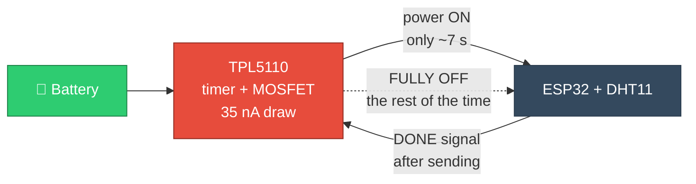

The TPL5110 powers the board up at a programmed interval (set with a potentiometer, from 100 ms to 2 hours). The ESP32 does its job, then pulls the `DONE` pin high — at which point the TPL5110 **physically cuts the power** through a built-in MOSFET. The TPL5110's own draw in the off state is **35 nA**, roughly **280,000 times less** than the current 10 mA.

**Estimated impact:**

| Configuration | Idle draw | Daily consumption | Battery life (2500 mAh) |
|---|---|---|---|
| Software deep sleep (current) | ~10 mA | ~323 mAh | **~8 days** |
| **+ TPL5110 (hardware)** | ~0.000035 mA | ~88 mAh | **~28 days** |
| **+ TPL5110 + wake time optimised to 4 s** | ~0.000035 mA | ~47 mAh | **~53 days** |

> A **3.5×** increase just from adding the hardware timer, and **~7×** combined with the shorter wake time.

**Alternatives in the same direction:** physically removing the power LED and the regulator from the DevKit (desoldering), or moving to a **bare ESP32-WROOM** module / **ESP32-C3 Super Mini** powered directly from 3.3 V — options that remove the same losses but need more hardware work.

---

### 2. Powering the board properly

The AMS1117 regulator on the DevKit needs a ~1.1 V dropout to regulate correctly. Fed on `VIN` from a 3.7 V Li-Ion battery, the regulator runs practically **in dropout** for almost the whole discharge cycle — which also explains the initial brownout suspicion.

**Solutions:** replace it with a low-dropout LDO (**MCP1700**, ~178 mV dropout) or use a **buck-boost** converter that holds a stable 3.3 V across the whole 3.0–4.2 V range.

### 3. Proper ADC calibration instead of a fixed offset

The `+0.35` offset is an empirical correction, valid at one temperature and for one board. The proper approach is to use the chip's eFuse calibration:

```cpp
uint32_t mv = analogReadMilliVolts(BATT_PIN);   // uses the calibrated Vref from eFuse
float voltage = (mv / 1000.0) * 2.0;
```

In addition, averaging 10–20 readings would reduce noise, and mapping onto the **real Li-Ion discharge curve** (non-linear) would be more accurate than a linear `map()`.

### 4. Disconnecting the divider when not measuring

The 2×100 kΩ divider draws ~21 µA continuously, even with the board fully off. An N-channel MOSFET in series with the ground leg, driven from a GPIO, would remove this parasitic draw. Alternatively, 1 MΩ resistors would cut the current tenfold.

### 5. A better sensor

The DHT11 has ±2 °C and ±5 % RH accuracy and cannot read below 0 °C — not enough for outdoor use. Drop-in replacements:

| Sensor | Temp. accuracy | Humidity accuracy | Interface | Bonus |
|---|---|---|---|---|
| **DHT22** | ±0.5 °C | ±2 % | 1-Wire | −40…80 °C |
| **AHT20** | ±0.3 °C | ±2 % | I²C | cheap, fast |
| **SHT31** | ±0.2 °C | ±2 % | I²C | industrial grade |
| **BME280** | ±0.5 °C | ±3 % | I²C | **+ atmospheric pressure** |

### 6. Firmware robustness

- `Blynk.begin()` is **blocking**: if the router is off, the ESP32 stays stuck forever trying to connect and drains the battery in a few hours. Replacing it with `WiFi.begin()` + a timeout and `Blynk.config()` / `Blynk.connect(timeout)` would let the system give up and go back to sleep.
- Saving the **Wi-Fi channel and BSSID** in RTC memory (which survives deep sleep) cuts the connection time from ~3 s to under 1 s — a direct battery saving on every cycle.
- Sending a **wake-up counter** as an extra datastream would make unexpected restarts detectable.

### 7. System extensions

- A 5 V / 1 W **solar panel** connected to the TP4056 input → practically unlimited battery life;
- A 2.13" **e-Paper display** for local readout (draws nothing when not refreshing);
- **More sensors** reporting to the same dashboard (one per room);
- A **local server** (MQTT + Home Assistant, or InfluxDB + Grafana) as an alternative to the public cloud;
- **OTA (Over-The-Air) updates** to update the firmware without opening the enclosure.

---

## 📁 Project structure

```
KenoTemp-IoT-Weather-Station/
├── src/
│   └── main.cpp                          # The complete firmware
├── include/
│   ├── secrets.h.example                 # Template for the private data
│   └── secrets.h                         # Your real data (ignored by Git)
├── hardware/
│   └── CarcasaTermo.stl                  # 3D model of the enclosure
├── docs/
│   ├── Jurnal-de-proiect.txt             # Development log
│   ├── KenoTemp-Prezentare.pptx          # Presentation for the university
│   ├── images/                           # Photos and screenshots
│   ├── data/                             # CSV export from Blynk
│   └── istoric/
│       └── main_v1_fara_calibrare.cpp.txt  # The version before the ADC calibration
├── platformio.ini                        # Build configuration + libraries
├── README.md                             # Documentation in English
└── README.ro.md                          # Documentation in Romanian
```

---

## 🖼️ Gallery

<div align="center">

| | |
|---|---|
|  | 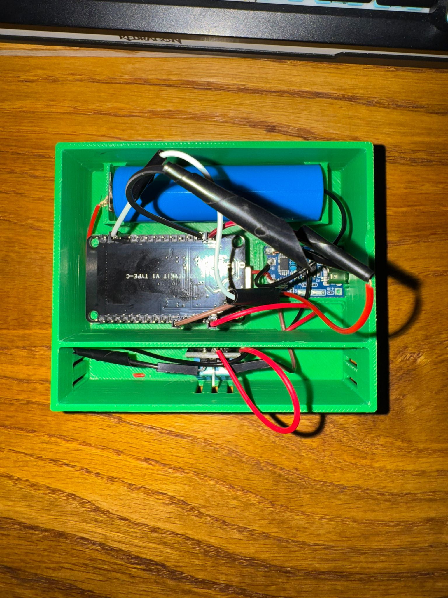 |
| *Measuring the real voltage with the multimeter — the test that exposed the ADC error* | *The ESP32, the 18650 cell and the TP4056 in place* |
|  |  |
| *The finished assembly, with the embossed logo on the lid* | *The charging port, reachable without opening the enclosure* |
|  |  |
| *The CAD model in Autodesk Fusion* | *The live dashboard in Blynk IoT* |
|  |  |
| *The low-battery automation rule* | *The push notification, delivered to the phone* |

</div>

---

## 📄 License

Distributed under the **MIT** license — see [`LICENSE`](LICENSE).

---

<div align="center">

**Made by [Ștefan Horia](https://github.com/StefanHoria)**

</div>
