*[English](README.md) · **Română***

<div align="center">

# 🌡️ KenoTemp

**Stație IoT autonomă pe baterie pentru monitorizarea temperaturii și umidității**

ESP32 · DHT11 · Li-Ion 18650 · Deep Sleep · Blynk IoT Cloud · Carcasă printată 3D

[](https://www.espressif.com/)
[](https://www.arduino.cc/)
[](https://platformio.org/)
[](https://blynk.io/)
[](LICENSE)

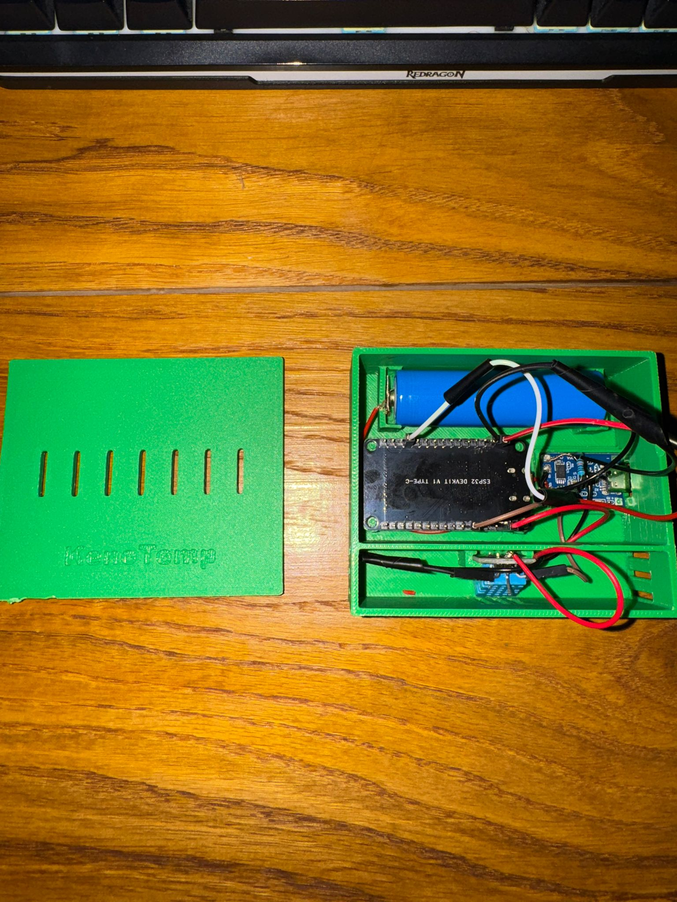

</div>

---

## 📋 Cuprins

- [Despre proiect](#-despre-proiect)
- [Funcționalități](#-funcționalități)
- [Componente utilizate](#-componente-utilizate)
- [Unelte și software](#-unelte-și-software)
- [Schema de conectare](#-schema-de-conectare)
- [Carcasa 3D](#-carcasa-3d)
- [Cum funcționează](#-cum-funcționează)
- [Instalare și rulare](#-instalare-și-rulare)
- [Configurare Blynk](#-configurare-blynk)
- [Consum și autonomie](#-consum-și-autonomie)
- [Probleme întâmpinate și soluții](#-probleme-întâmpinate-și-soluții)
- [Îmbunătățiri viitoare](#-îmbunătățiri-viitoare)
- [Structura proiectului](#-structura-proiectului)
- [Galerie](#-galerie)
- [Licență](#-licență)

---

## 🎯 Despre proiect

**KenoTemp** este o stație de monitorizare ambientală complet autonomă, alimentată de o singură celulă Li-Ion 18650. Măsoară temperatura și umiditatea, își raportează propriul nivel de baterie și trimite totul într-un dashboard cloud accesibil de pe telefon sau browser.

Ideea centrală a proiectului nu este senzorul în sine — ci **managementul energetic**. Un ESP32 lăsat permanent conectat la Wi-Fi consumă în jur de 80–150 mA și golește o baterie 18650 în mai puțin de o zi. KenoTemp rezolvă asta prin **Deep Sleep**: placa este trează aproximativ 7 secunde la fiecare 5 minute, restul timpului doarme.

Rezultat: sistemul stă **~7–8 zile** cu o singură încărcare, față de **sub 24 de ore** fără deep sleep.

Întregul ansamblu stă într-o carcasă proiectată în Autodesk Fusion și printată 3D, gata de montat pe perete.

> 📖 Jurnalul complet de dezvoltare, cu deciziile luate pe parcurs: [`docs/Jurnal-de-proiect.txt`](docs/Jurnal-de-proiect.txt)

---

## ✨ Funcționalități

| | |
|---|---|
| 🌡️ **Temperatură și umiditate** | Citire prin senzor DHT11, transmisă la fiecare 5 minute |
| 🔋 **Monitorizare baterie** | Divizor rezistiv + ADC intern → tensiune brută (V) și procentaj (%) |
| 😴 **Deep Sleep** | ~7 s activ / 300 s somn — reduce consumul mediu de peste 10× |
| ☁️ **Dashboard cloud** | Blynk IoT — grafice live, istoric, export CSV |
| 📱 **Notificare push** | Alertă automată pe telefon când bateria scade sub 20% |
| 🔌 **Reîncărcare USB** | Modul TP4056 cu protecție la supra/sub-tensiune, port Type-C accesibil din carcasă |
| 📦 **Carcasă proprie** | Proiectată în Fusion, printată pe Creality Ender-3 V3 KE, cu fante de ventilație |

---

## 🔧 Componente utilizate

| # | Componentă | Rol în proiect | Specificații relevante | Preț orientativ |
|---|---|---|---|---|
| 1 | **ESP32 DevKit V1 (Type-C)** | Creierul sistemului — citește senzorii, se conectează la Wi-Fi, trimite datele, intră în deep sleep | Dual-core Xtensa 240 MHz, Wi-Fi 2.4 GHz + BT, 520 KB SRAM, 4 MB flash, ADC 12-bit | ~35–50 lei |
| 2 | **Senzor DHT11** | Măsoară temperatura și umiditatea aerului | 0–50 °C (±2 °C), 20–90 % RH (±5 %), interfață 1-Wire proprietar | ~8–12 lei |
| 3 | **Acumulator Li-Ion 18650** | Sursa de energie a întregului sistem | 3,7 V nominal (3,0–4,2 V), ~2500 mAh | ~15–30 lei |
| 4 | **Modul TP4056 cu protecție** | Încărcare CC/CV prin USB + protecție la supradescărcare, supraîncărcare și scurtcircuit | Curent de încărcare 1 A, intrare USB Type-C | ~5–8 lei |
| 5 | **2 × rezistență 100 kΩ** | Divizor de tensiune 1:2 — coboară cei 4,2 V ai bateriei sub limita de 3,3 V a ADC-ului | Toleranță 5 %, consum continuu ~21 µA | ~1 leu |
| 6 | **Fire dupont / lițate + lipituri** | Interconectarea modulelor | — | ~5 lei |
| 7 | **Filament PLA (verde)** | Carcasa printată 3D | ~45 g material | ~5 lei |
| | | | **Total** | **~75–110 lei** |

<div align="center">
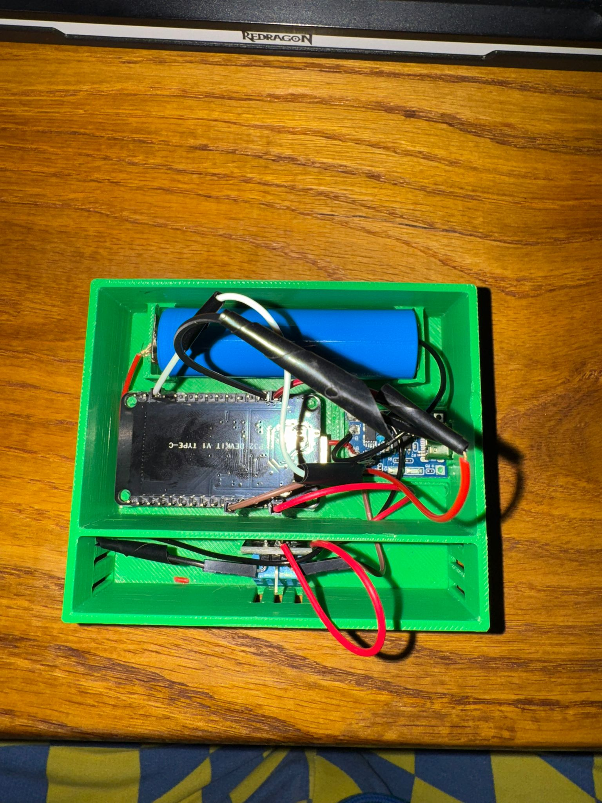
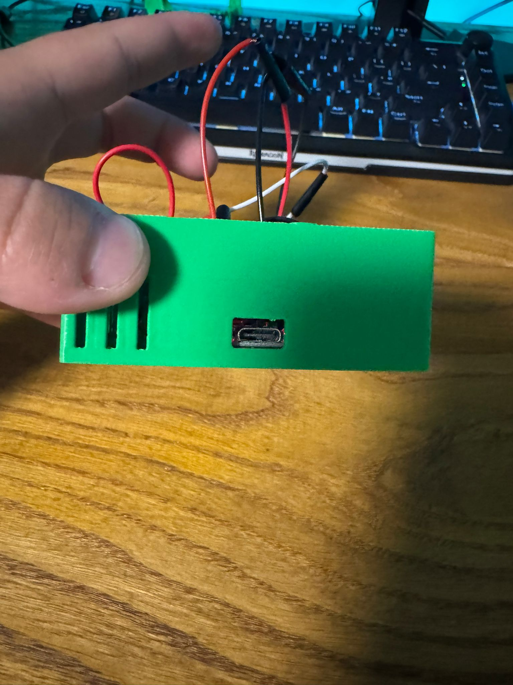
</div>

---

## 🛠️ Unelte și software

| Unealtă | Utilizare |
|---|---|
| **VS Code + PlatformIO** | Mediul de dezvoltare, compilare și upload firmware |
| **Autodesk Fusion** | Proiectarea 3D a carcasei (CAD) |
| **Creality Print / slicer** | Feliere model → G-code |
| **Creality Ender-3 V3 KE** | Printarea efectivă a carcasei |
| **Blynk IoT** | Platforma cloud: dashboard, datastreams, automatizări, notificări |
| **Multimetru digital** | Măsurarea tensiunii reale a bateriei — a scos la iveală eroarea ADC-ului |
| **Letcon + cutter** | Lipituri și ajustarea mecanică a carcasei |
| **Serial Monitor (115200 baud)** | Debugging live al firmware-ului |

**Biblioteci** (rezolvate automat de PlatformIO din [`platformio.ini`](platformio.ini)):

```ini
lib_deps =
    adafruit/DHT sensor library @ ^1.4.4
    adafruit/Adafruit Unified Sensor @ ^1.1.9
    blynkkk/Blynk @ ^1.3.2
```

---

## 🔌 Schema de conectare

### Tabel de cablare

| De la | La | Observații |
|---|---|---|
| Baterie 18650 **+** | TP4056 **B+** | |
| Baterie 18650 **−** | TP4056 **B−** | |
| TP4056 **OUT+** | ESP32 **VIN** | Alimentarea plăcii |
| TP4056 **OUT−** | ESP32 **GND** | Masă comună |
| DHT11 **VCC** | ESP32 **3V3** | |
| DHT11 **GND** | ESP32 **GND** | |
| DHT11 **DATA** | ESP32 **GPIO 4** | `#define DHTPIN 4` |
| TP4056 **OUT+** | R1 (100 kΩ) → nod | Ramura superioară a divizorului |
| nod | R2 (100 kΩ) → **GND** | Ramura inferioară |
| nod (mijloc divizor) | ESP32 **GPIO 34** | `#define BATT_PIN 34` — pin doar-intrare, ADC1 |

### Divizorul de tensiune

```
   BAT+ (3,0 – 4,2 V)
        │
       ┌┴┐
       │ │ R1 = 100 kΩ
       └┬┘
        ├──────────────► GPIO 34  (1,50 – 2,10 V — sigur pentru ADC)
       ┌┴┐
       │ │ R2 = 100 kΩ
       └┬┘
        │
       GND
```

Raportul 1:2 face ca maximul de **4,2 V** al bateriei să ajungă la **2,1 V** pe pinul analogic — confortabil sub limita de 3,3 V. În cod, tensiunea reală se reconstituie prin înmulțire cu 2:

```cpp
int   rawADC  = analogRead(BATT_PIN);
float voltage = (rawADC / 4095.0) * 3.3 * 2.0;
voltage = voltage + 0.35;   // calibrare — vezi secțiunea "Probleme întâmpinate"
```

### Diagrama sistemului

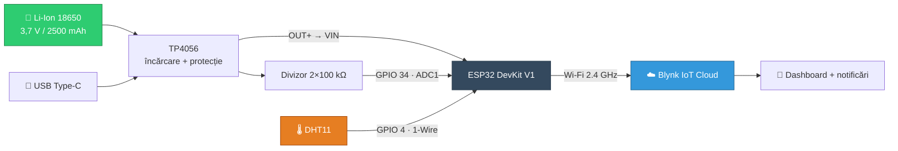

---

## 📦 Carcasa 3D

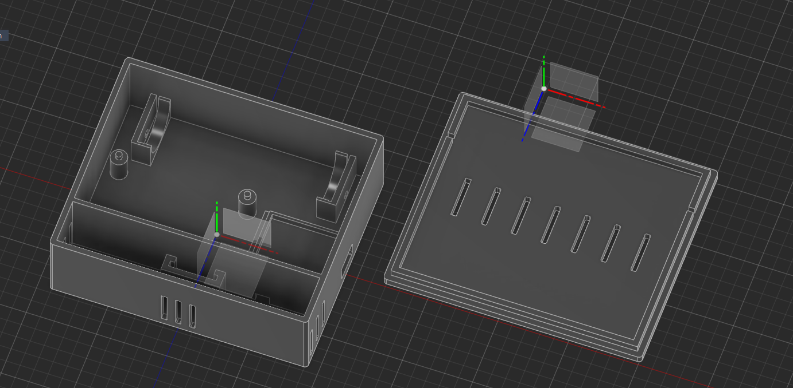

Carcasa a fost proiectată de la zero în **Autodesk Fusion**, în două piese:

- **Baza** — cu suport dedicat pentru celula 18650, locașuri pentru ESP32 și TP4056, decupaj lateral pentru portul USB Type-C și fante de ventilație pe lateral;
- **Capacul** — cu fante de aerisire deasupra senzorului (fără ele, DHT11 ar citi aerul stătut din cutie, nu pe cel din cameră) și logo-ul **KenoTemp** în relief.

📄 Fișierul pentru print: [`hardware/CarcasaTermo.stl`](hardware/CarcasaTermo.stl)

**Parametri de printare folosiți:**

| Parametru | Valoare |
|---|---|
| Imprimantă | Creality Ender-3 V3 KE |
| Material | PLA |
| Înălțime strat | 0,2 mm |
| Infill | 15 % |
| Suporturi | Nu |
| Perimetre | 3 |

---

## ⚙️ Cum funcționează

Firmware-ul nu are practic `loop()` — tot codul stă în `setup()`, pentru că **fiecare trezire din deep sleep repornește microcontrollerul de la zero**, ca un reset. Ciclul complet arată așa:

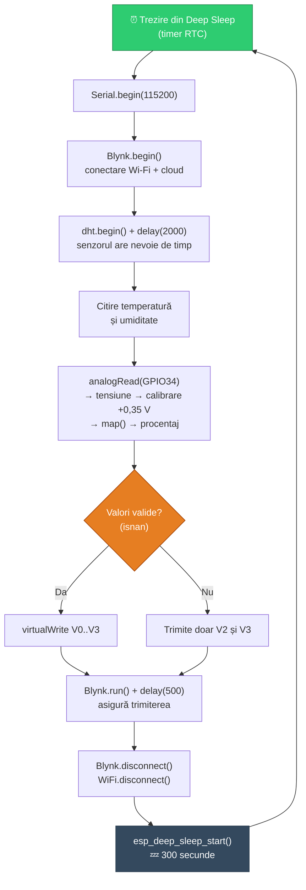

### Datastreams trimise către cloud

| Pin virtual | Mărime | Unitate | Interval |
|---|---|---|---|
| `V0` | Temperatură | °C | −20 … 60 |
| `V1` | Umiditate | % RH | 0 … 100 |
| `V2` | Tensiune baterie | V | 0 … 5 |
| `V3` | Procentaj baterie | % | 0 … 100 |

---

## 🚀 Instalare și rulare

### 1. Clonează proiectul

```bash
git clone https://github.com/StefanHoria/KenoTemp-IoT-Weather-Station.git
```

### 2. Creează fișierul cu date private

Datele sensibile (token Blynk + parola Wi-Fi) **nu sunt în repository**. Copiază șablonul și completează-l cu datele tale:

```bash
cp include/secrets.h.example include/secrets.h
```

Pe Windows:

```bash
copy include\secrets.h.example include\secrets.h
```

Apoi editează [`include/secrets.h`](include/secrets.h.example):

```cpp
#define BLYNK_TEMPLATE_ID   "TMPLxxxxxxxxx"
#define BLYNK_TEMPLATE_NAME "KenoTemp"
#define BLYNK_AUTH_TOKEN    "tokenul_tau_de_32_de_caractere"

#define WIFI_SSID "NumeleRetelei"
#define WIFI_PASS "ParolaRetelei"
```

> ⚠️ ESP32 funcționează **doar pe Wi-Fi 2.4 GHz**. Rețelele de 5 GHz nu vor fi găsite.

### 3. Compilează și încarcă

```bash
pio run --target upload
```

### 4. Urmărește execuția

```bash
pio device monitor -b 115200
```

Ieșire așteptată:

```
--- Sistemul s-a trezit ---
Ma conectez la WiFi si Blynk...
Date citite. Trimit catre platforma...
Date trimise! Intru in Deep Sleep... Zzz
```

### Resurse ocupate (build real)

| | Folosit | Total | |
|---|---|---|---|
| **RAM** | 45,2 KB | 320 KB | 13,8 % |
| **Flash** | 768 KB | 1,25 MB | 58,6 % |

---

## ☁️ Configurare Blynk

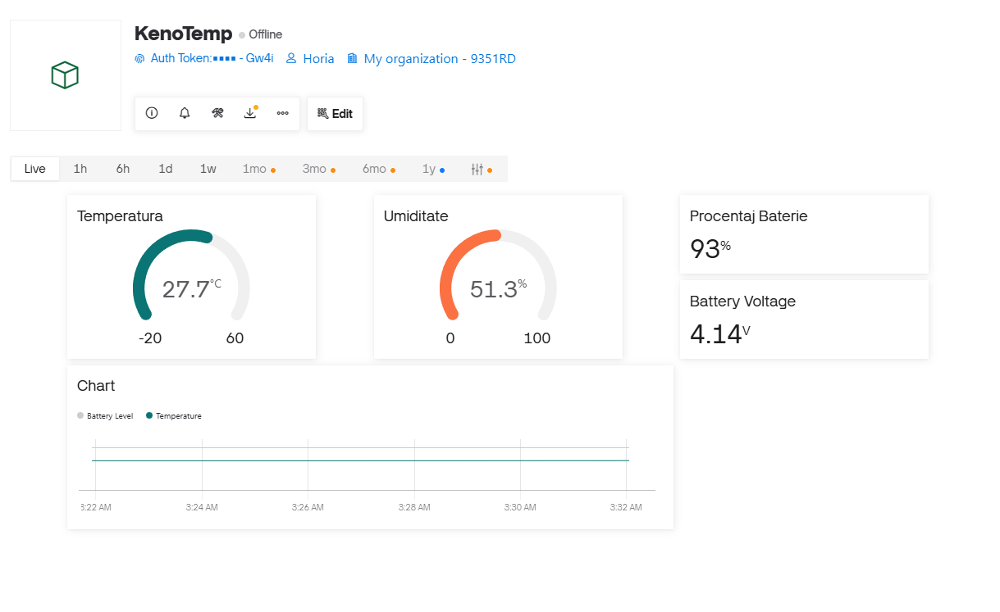

1. Creează un **Template** nou în [Blynk Console](https://blynk.cloud) → notează `TEMPLATE_ID` și `AUTH_TOKEN`.
2. În **Datastreams**, adaugă patru pini virtuali conform tabelului de mai sus (V0–V3).
3. În **Web Dashboard**, adaugă widget-uri: două *Gauge* (temperatură, umiditate), două *Label* (tensiune, procentaj) și un *Chart*.
4. Pentru notificarea de baterie descărcată, mergi la **Automations** → *When device state changes*.

### Automatizarea de baterie descărcată

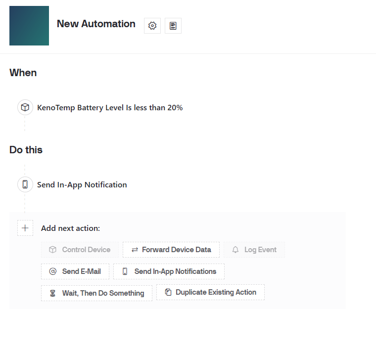

| Condiție | Acțiune |
|---|---|
| `KenoTemp Battery Level` **< 20 %** | Trimite notificare in-app pe telefon |

Rezultatul, pe telefon:

<div align="center">
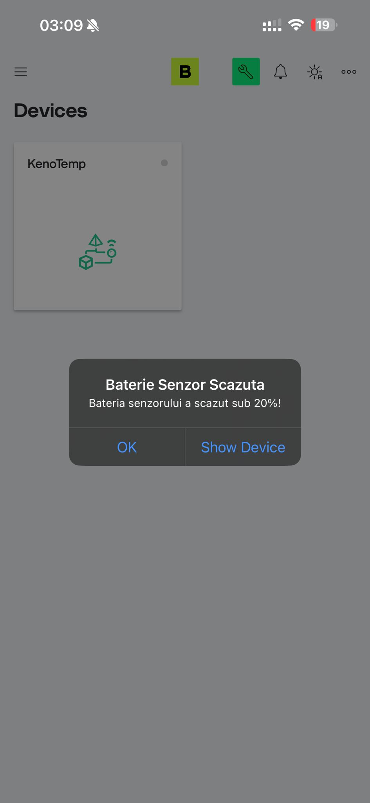
</div>

> 💡 **Important:** pentru ca `V3` să apară în lista de automatizări, datastream-ul trebuie marcat explicit ca **„Sensor"** în secțiunea *Automations* a editorului de datastream. Vezi [Probleme întâmpinate](#-probleme-întâmpinate-și-soluții).

---

## 🔋 Consum și autonomie

### Măsurători și calcul

| Fază | Durată | Curent estimat | Energie / ciclu |
|---|---|---|---|
| **Activ** (Wi-Fi + citire + transmisie) | ~7,5 s | ~150 mA | 0,313 mAh |
| **Deep Sleep** (placă DevKit completă) | 300 s | ~10 mA | 0,833 mAh |
| | | **Total ciclu (307,5 s)** | **~1,15 mAh** |

```
Cicluri pe zi     = 86.400 s / 307,5 s   ≈ 281
Consum zilnic     = 281 × 1,15 mAh       ≈ 323 mAh
Autonomie (2500 mAh) = 2500 / 323        ≈ 7,7 zile
```

### 🚨 Observația-cheie

**72 % din energie se consumă în timpul „somnului".**

Cipul ESP32 în sine consumă doar ~10 µA în deep sleep. Însă placa **DevKit** are pe ea un regulator liniar AMS1117 și un cip USB-serial care rămân alimentate permanent și trag împreună ~8–12 mA — indiferent dacă microcontrollerul doarme sau nu.

Deep Sleep-ul software rezolvă doar jumătate din problemă. Aceasta este exact motivația pentru îmbunătățirea principală propusă mai jos.

---

## 🐛 Probleme întâmpinate și soluții

### 1. Eroarea convertorului ADC — decalaj de 0,35 V

| | |
|---|---|
| **Simptom** | Multimetrul arăta bateria plină la **4,20 V**, dar ESP32 raporta pe Blynk doar **3,85 V**. Procentajul afișat era complet greșit. |
| **Cauză** | Trei factori cumulați: ADC-ul intern al ESP32 este notoriu neliniar la capătul superior al scalei, tensiunea de referință reală diferă de cei 3,3 V presupuși în formulă, iar rezistențele de 100 kΩ au toleranță de 5 %. |
| **Soluție** | Calibrare software prin offset măsurat cu multimetrul: `voltage = voltage + 0.35;` înainte de calculul procentajului. |
| **Rezultat** | Valoarea raportată coincide acum cu cea măsurată la bornele bateriei. |

### 2. Blynk: „No datastreams exposed for automation"

| | |
|---|---|
| **Simptom** | Regula de notificare pentru baterie descărcată nu putea fi creată — platforma nu vedea niciun datastream disponibil. |
| **Cauză** | Din motive de siguranță, Blynk nu expune automat pinii virtuali către motorul de automatizări. |
| **Soluție** | Deblocarea template-ului din Web Dashboard → editare datastream `V3` → marcare explicită ca **„Sensor"** în secțiunea *Automations*. |
| **Rezultat** | Notificarea push funcționează. |

### 3. „Sindromul butonului apăsat" — cea mai costisitoare problemă

| | |
|---|---|
| **Simptom** | După asamblarea în carcasa printată și trecerea pe baterie, placa nu mai trimitea absolut nicio dată. Pe USB, în afara carcasei, funcționa perfect. |
| **Ipoteza inițială** | *Brownout* — cădere de tensiune la pornirea radioului Wi-Fi, din cauza rezistenței firelor subțiri. Zeci de teste, resetări manuale și verificări de alimentare nu au dus nicăieri. |
| **Cauza reală** | Complet mecanică: toleranțele peretelui interior al carcasei printate țineau **butonul fizic EN (Reset)** al plăcii ușor apăsat. ESP32-ul stătea blocat într-un reset perpetuu. |
| **Soluție** | Rașchetarea câtorva zecimi de milimetru din plasticul interior cu un cutter, pentru a elibera butonul. |
| **Lecție** | Într-un proiect hardware/software, un simptom software poate avea o cauză pur mecanică. Toleranțele de printare 3D contează. |

---

## 🔮 Îmbunătățiri viitoare

### ⭐ 1. Deep Sleep hardware — nu doar software (prioritatea #1)

Aceasta este cea mai importantă îmbunătățire posibilă și rezolvă direct problema identificată în secțiunea de consum: **placa DevKit continuă să tragă ~10 mA chiar și în deep sleep**, din cauza regulatorului AMS1117 și a cipului USB-serial care rămân permanent alimentate.

**Soluția:** un temporizator hardware de tip **TI TPL5110** (sau TPL5111), care **taie complet alimentarea** întregii plăci între citiri.

**Cum funcționează:**

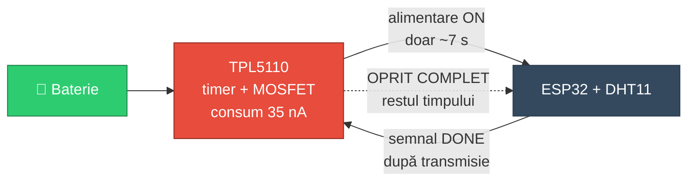

TPL5110 pornește placa la interval programat (reglabil cu un potențiometru, între 100 ms și 2 ore). ESP32 își face treaba, apoi trage pinul `DONE` în sus — moment în care TPL5110 **întrerupe fizic alimentarea** printr-un MOSFET integrat. Consumul propriu al TPL5110 în starea oprită este de **35 nA**, adică de aproximativ **280.000 de ori mai mic** decât cei 10 mA actuali.

**Impact estimat:**

| Configurație | Consum în repaus | Consum zilnic | Autonomie (2500 mAh) |
|---|---|---|---|
| Deep Sleep software (actual) | ~10 mA | ~323 mAh | **~8 zile** |
| **+ TPL5110 (hardware)** | ~0,000035 mA | ~88 mAh | **~28 zile** |
| **+ TPL5110 + trezire optimizată la 4 s** | ~0,000035 mA | ~47 mAh | **~53 zile** |

> Creștere de **3,5×** doar din adăugarea temporizatorului hardware, și de **~7×** combinat cu optimizarea timpului de trezire.

**Alternative pe aceeași direcție:** eliminarea fizică a LED-ului de alimentare și a regulatorului de pe DevKit (dezlipire), sau trecerea la un modul **ESP32-WROOM gol** / **ESP32-C3 Super Mini**, alimentat direct pe 3,3 V — variante care elimină aceleași pierderi, dar necesită mai multă intervenție hardware.

---

### 2. Alimentare corectă a plăcii

Regulatorul AMS1117 de pe DevKit are nevoie de o cădere de tensiune de ~1,1 V pentru a regla corect. Alimentat pe `VIN` de la o baterie Li-Ion de 3,7 V, regulatorul funcționează practic **în dropout** pe aproape tot ciclul de descărcare — ceea ce explică și suspiciunea inițială de brownout.

**Soluții:** înlocuirea cu un regulator LDO cu cădere mică (**MCP1700**, ~178 mV dropout) sau folosirea unui convertor **buck-boost** care menține 3,3 V stabili pe tot intervalul 3,0–4,2 V.

### 3. Calibrare ADC corectă în locul offset-ului fix

Offset-ul `+0.35` este o corecție empirică, validă la o singură temperatură și pentru o singură placă. Varianta corectă este folosirea calibrării din eFuse a cipului:

```cpp
uint32_t mv = analogReadMilliVolts(BATT_PIN);   // folosește Vref calibrat din eFuse
float voltage = (mv / 1000.0) * 2.0;
```

În plus, o medie pe 10–20 de citiri ar reduce zgomotul, iar mapare pe **curba reală de descărcare Li-Ion** (neliniară) ar fi mai precisă decât `map()` liniar.

### 4. Deconectarea divizorului când nu se măsoară

Divizorul de 2×100 kΩ trage continuu ~21 µA, chiar și cu placa complet oprită. Un MOSFET cu canal N în serie cu ramura de masă, comandat dintr-un GPIO, ar elimina acest consum parazit. Alternativ, rezistențe de 1 MΩ ar reduce curentul de 10 ori.

### 5. Senzor mai bun

DHT11 are o precizie de ±2 °C și ±5 % RH și nu citește sub 0 °C — insuficient pentru utilizare în exterior. Înlocuitori direcți:

| Senzor | Precizie temp. | Precizie umid. | Interfață | Bonus |
|---|---|---|---|---|
| **DHT22** | ±0,5 °C | ±2 % | 1-Wire | −40…80 °C |
| **AHT20** | ±0,3 °C | ±2 % | I²C | ieftin, rapid |
| **SHT31** | ±0,2 °C | ±2 % | I²C | calitate industrială |
| **BME280** | ±0,5 °C | ±3 % | I²C | **+ presiune atmosferică** |

### 6. Robustețe în firmware

- `Blynk.begin()` este **blocant**: dacă routerul este oprit, ESP32 rămâne blocat la infinit încercând să se conecteze și golește bateria în câteva ore. Înlocuirea cu `WiFi.begin()` + timeout și `Blynk.config()` / `Blynk.connect(timeout)` ar face sistemul să renunțe și să se întoarcă la somn.
- Salvarea **canalului Wi-Fi și a BSSID-ului** în memoria RTC (care supraviețuiește deep sleep-ului) reduce timpul de conectare de la ~3 s la sub 1 s — o economie directă de baterie la fiecare ciclu.
- Trimiterea unui **contor de treziri** ca datastream suplimentar ar permite detectarea repornirilor neașteptate.

### 7. Extinderi de sistem

- **Panou solar** de 5 V / 1 W conectat la intrarea TP4056 → autonomie practic nelimitată;
- **Ecran e-Paper** de 2,13" pentru afișare locală (consumă zero când nu se actualizează);
- **Mai mulți senzori** raportând în același dashboard (câte o cameră);
- **Server local** (MQTT + Home Assistant sau InfluxDB + Grafana) ca alternativă la cloud-ul public;
- **OTA (Over-The-Air update)** pentru actualizarea firmware-ului fără a deschide carcasa.

---

## 📁 Structura proiectului

```
KenoTemp-IoT-Weather-Station/
├── src/
│   └── main.cpp                          # Firmware-ul complet
├── include/
│   ├── secrets.h.example                 # Șablon pentru datele private
│   └── secrets.h                         # Datele tale reale (ignorat de Git)
├── hardware/
│   └── CarcasaTermo.stl                  # Modelul 3D al carcasei
├── docs/
│   ├── Jurnal-de-proiect.txt             # Jurnalul de dezvoltare
│   ├── KenoTemp-Prezentare.pptx          # Prezentarea pentru facultate
│   ├── images/                           # Fotografii și capturi de ecran
│   ├── data/                             # Export CSV din Blynk
│   └── istoric/
│       └── main_v1_fara_calibrare.cpp.txt  # Versiunea dinaintea calibrării ADC
├── platformio.ini                        # Configurare build + biblioteci
├── README.md                             # Documentația în engleză
└── README.ro.md                          # Documentația în română
```

---

## 🖼️ Galerie

<div align="center">

| | |
|---|---|
|  | 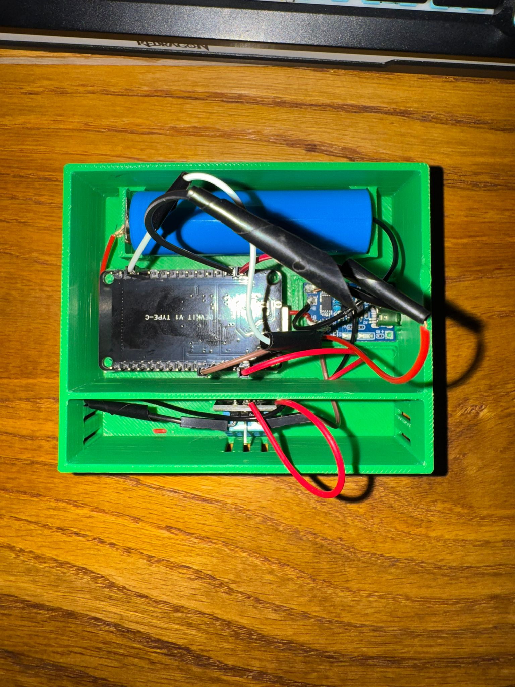 |
| *Măsurarea tensiunii reale cu multimetrul — testul care a scos la iveală eroarea ADC* | *ESP32, celula 18650 și TP4056 la locul lor* |
|  |  |
| *Ansamblul finit, cu capacul purtând logo-ul în relief* | *Portul de încărcare accesibil fără deschiderea carcasei* |
|  |  |
| *Modelul CAD în Autodesk Fusion* | *Dashboard-ul live din Blynk IoT* |
|  |  |
| *Regula de automatizare pentru baterie descărcată* | *Notificarea push, ajunsă pe telefon* |

</div>

---

## 📄 Licență

Distribuit sub licența **MIT** — vezi [`LICENSE`](LICENSE).

---

<div align="center">

**Realizat de [Ștefan Horia](https://github.com/StefanHoria)**

</div>
